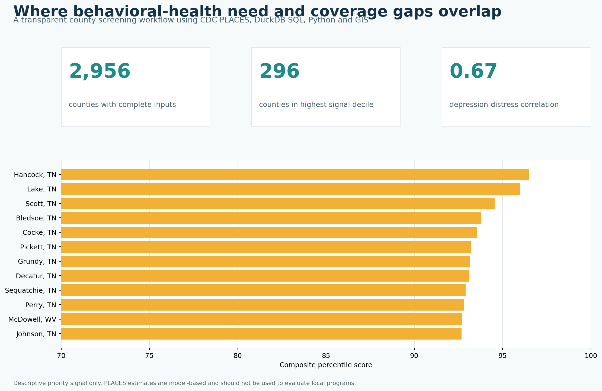
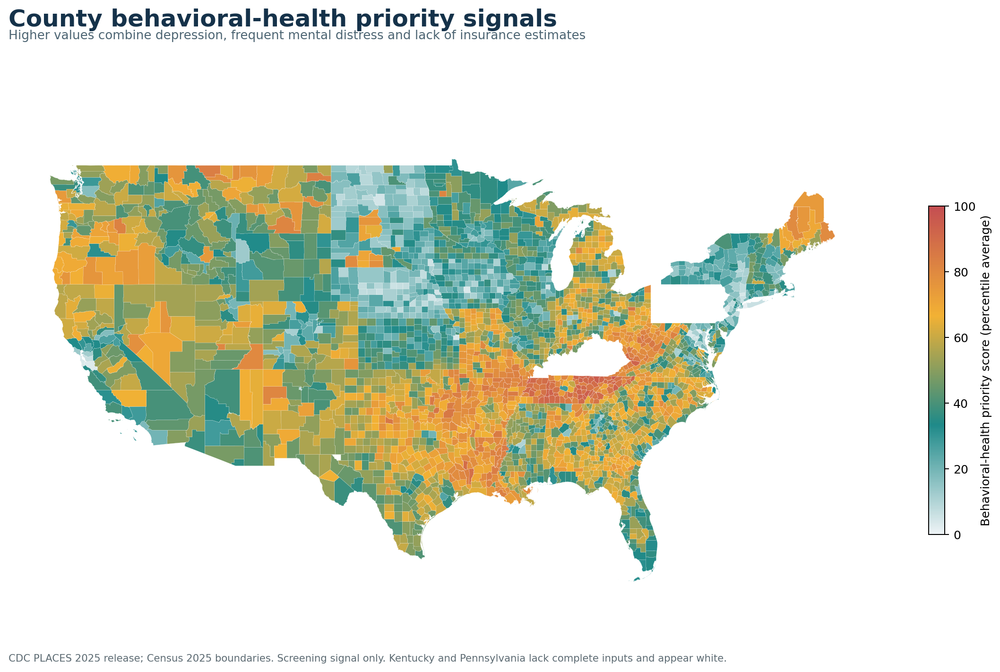

# County Behavioral Health Priority Signals

[](https://www.python.org/) [](https://duckdb.org/) [](https://qgis.org/) [](https://data.cdc.gov/500-Cities-Places/PLACES-County-Data-GIS-Friendly-Format-2025-release/i46a-9kgh)



## Executive summary

Public-health planners often need to identify where behavioral-health need and access barriers may overlap before committing scarce analytic or outreach resources. This project turns the CDC PLACES 2025 county release into a transparent screening workflow that combines three model-based, age-adjusted estimates:

- diagnosed depression among adults;
- frequent mental distress among adults; and
- lack of health insurance among adults ages 18–64.

DuckDB SQL ranks each measure nationally and averages the three percentile ranks into a documented priority score. Python automates acquisition, QA, analysis, GIS joins and publication-quality graphics. QGIS-ready GeoJSON, GeoPackage and style files support further exploration.

This score is a planning signal, not a validated clinical index, causal model or program evaluation.

## What the analysis found

- **2,956 of 3,143 counties (94.1%)** had complete values for all three inputs. All 120 Kentucky counties and 67 Pennsylvania counties lacked these components in the source extract and were excluded.
- **296 counties** formed the highest composite-signal decile, representing about **8.0 million residents**.
- County depression and frequent mental distress estimates were positively correlated (**Pearson r = 0.67**), but coverage gaps varied within that relationship.
- The population-weighted mean county estimate in the highest decile was **29.5% for depression** and **21.7% for frequent mental distress**, compared with **21.9%** and **17.1%** across other eligible counties. These are descriptive weighted summaries of county model estimates, not individual-level national prevalence estimates.
- Tennessee contributed **83** highest-decile counties, followed by West Virginia (**34**), Louisiana (**31**) and Arkansas (**29**). Kentucky and Pennsylvania cannot be compared because their counties lacked complete inputs. The concentration is a prioritization prompt, not evidence that geography caused the outcomes.



## Decision use case

The workflow is designed for an epidemiology, community-health or payer analytics team deciding where to:

1. review local service capacity and claims data;
2. validate priorities with community and state partners;
3. examine rurality, provider availability and transportation barriers; and
4. choose locations for a deeper needs assessment.

The ranking should never be used as the sole basis for funding, staffing or labeling a community.

## Reproduce the project

```bash
python -m venv .venv
# Windows: .venv\Scripts\activate
# macOS/Linux: source .venv/bin/activate
pip install -r requirements.txt
python scripts/run_analysis.py
python -m unittest discover -s tests -v
```

The script downloads the current selected-column CDC extract and Census boundary file, then rebuilds all processed data, tables, GIS outputs and figures. Raw downloads are ignored by Git; their SHA-256 hashes are recorded in [`outputs/qa_report.json`](outputs/qa_report.json).

## Repository map

```text
├── data/
│   ├── README.md
│   └── processed/                 # CSV, GeoJSON and GeoPackage
├── docs/                          # methods, dictionary, references and review materials
├── gis/                           # QGIS instructions and reusable style
├── outputs/
│   ├── figures/                   # publication-ready PNGs
│   ├── tables/                    # top counties, state summary and metrics
│   └── qa_report.json
├── scripts/run_analysis.py        # end-to-end acquisition and analysis
├── sql/priority_scoring.sql       # auditable DuckDB scoring logic
└── tests/test_outputs.py          # automated data and artifact checks
```

## Methods in two minutes

1. Download selected CDC PLACES county fields through the Socrata API.
2. Require complete values for the three inputs and validate FIPS keys and plausible ranges.
3. Use DuckDB `percent_rank()` to convert each measure to a national percentile.
4. Average the three ranks with equal weighting.
5. Assign score deciles and identify decile 10 as the highest signal group.
6. Join results to the Census Bureau 2025 county cartographic boundary file.
7. Export analysis tables, static figures and QGIS-ready layers.

See [`docs/METHODS.md`](docs/METHODS.md) for full definitions and interpretation guardrails.

## Data quality, ethics and limitations

- PLACES estimates are model-based, not direct county survey estimates.
- CDC states that the small-area model cannot detect local intervention effects; these data should not be used for program evaluation.
- The insurance denominator differs from the behavioral-health denominators, which is why the analysis combines ranks rather than raw percentages.
- Equal weighting is transparent but subjective and has not been clinically validated.
- Ecological results do not describe individual risk and should be paired with local qualitative and administrative data.
- Counties with an incomplete component are excluded. The missing counties are concentrated entirely in Kentucky and Pennsylvania, so state comparisons are incomplete.
- No person-level data, PHI, credentials or proprietary Texas DSHS information are used.

## Tools demonstrated

**Python** · **DuckDB SQL** · **pandas** · **GeoPandas** · **QGIS-ready GIS** · **data validation** · **reproducible public-health analytics** · **risk communication**

## Author

**Kira Gor, BDS, MPH**<br>
Epidemiology and healthcare data analytics<br>
[Portfolio](https://gorkira28.github.io/) · [LinkedIn](https://www.linkedin.com/in/dr-kira-gor/)

## License and citation

Code is released under the [MIT License](LICENSE). Source data retain their publisher terms and attribution. Citation metadata are available in [`CITATION.cff`](CITATION.cff).
